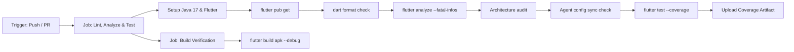

# Flutter Application Template

[](https://github.com/your-org/app_template/actions/workflows/ci.yml)
[](https://flutter.dev)
[](https://dart.dev)
[](#architecture--layering)
[](https://bloclibrary.dev)

A production-ready Flutter enterprise starter template built following the **Flutter Application Architecture Standard (v1.0)** — organized as **feature-first Modular MVC** with **Clean Architecture boundaries**.

---

## Table of Contents
- [Tech Stack](#tech-stack)
- [Prerequisites & System Requirements](#prerequisites--system-requirements)
- [Getting Started & Local Setup](#getting-started--local-setup)
- [Running the App & Environments](#running-the-app--environments)
- [Architecture & Layering](#architecture--layering)
- [Continuous Integration (CI/CD)](#continuous-integration-cicd)
- [Testing & Quality Assurance](#testing--quality-assurance)
- [Scaffolding New Features](#scaffolding-new-features)
- [AI Agent Integration](#ai-agent-integration-agent--claude)
- [Architectural Guardrails & Anti-Patterns](#architectural-guardrails--anti-patterns)

---

## Tech Stack

| Category | Technology | Purpose |
|---|---|---|
| **Framework / Language** | Flutter 3.47+ / Dart 3.13+ | Cross-platform core; Material and Cupertino via `material_ui` / `cupertino_ui` |
| **State Management** | `flutter_bloc` + `equatable` | Unidirectional data flow, predictable states |
| **API Client** | `dio` | Centralized HTTP client, interceptors, error mapping |
| **Dependency Injection** | `get_it` | Inversion of control, service locator |
| **Navigation** | `go_router` | Declarative routing, auth redirect, deep linking |
| **Serialization** | `json_serializable` | Type-safe JSON parsing via code generation |
| **Local Storage** | `shared_preferences` & `flutter_secure_storage` | Separation of preferences vs. encrypted auth tokens |
| **Image Caching** | `cached_network_image` | Efficient remote image loading & memory caching |
| **Localization** | `flutter_localizations` + gen-l10n | All UI text in `lib/core/l10n/arb/*.arb`, accessed via `context.l10n` |
| **Formatting** | `intl` | Currencies, dates, relative timestamps |
| **Crash Reporting** | `firebase_crashlytics` (abstracted) | Centralized error capturing with graceful debug fallback |
| **Testing** | `flutter_test`, `bloc_test`, `mocktail` | Unit, BLoC, and Widget test coverage |
| **Linter** | `flutter_lints` | Official Dart/Flutter analysis standards |

---

## Prerequisites & System Requirements

Before running the project, ensure you have the following installed on your machine:
- **Flutter SDK**: `>= 3.44.0` ([Install Guide](https://docs.flutter.dev/get-started/install))
- **Dart SDK**: `>= 3.12.0` (bundled with Flutter)
- **Git**: `>= 2.30`
- **Android Studio** (for Android emulator/builds) and/or **Xcode** (macOS only, for iOS simulator)
- **VS Code** or **Android Studio** with the official Dart and Flutter plugins

Verify your Flutter environment by running:
```bash
flutter doctor
```

---

## Getting Started & Local Setup

### 1. Clone the Repository
```bash
git clone https://github.com/your-org/app_template.git
cd app_template
```

### 2. Create Your `.env`
Copy the committed example (the real `.env` is git-ignored):
```bash
cp .env.example .env
```

### 3. Install Dependencies
Fetch all package dependencies:
```bash
flutter pub get
```

### 4. Run Code Generation
The project uses `json_serializable` to generate model serialization code (`*.g.dart`). Generate the missing files:
```bash
dart run build_runner build
```

*(Optional: Run `dart run build_runner watch` during development to auto-regenerate models on save).*

### 5. Verify Static Analysis and Tests
Ensure the setup compiles cleanly:
```bash
flutter analyze
flutter test
```

---

## Running the App & Environments

The template uses a single **`.env`** file in the root directory for all environments (created from the committed `.env.example`; never commit `.env`, and never put real secrets in it, because `--dart-define` values are compiled into the app). You can easily switch between Development, Staging, and Production by commenting / uncommenting lines in `.env`.

### 1. Environment Setup (`.env`)

Inside `.env`:
```properties
# ─── 1. DEVELOPMENT (Default Active) ────────────────────────────
BASE_URL=https://api-dev.example.com/v1
ENABLE_LOGGING=true

# ─── 2. STAGING (Uncomment to switch to Staging) ─────────────────
# BASE_URL=https://api-staging.example.com/v1
# ENABLE_LOGGING=true

# ─── 3. PRODUCTION (Uncomment to switch to Production) ──────────
# BASE_URL=https://api.example.com/v1
# ENABLE_LOGGING=false
```

### 2. Run the App:

Run the app using the single `.env` file:
```bash
# Debug Run
flutter run --dart-define-from-file=.env

# Release Build / Run
flutter run --release --dart-define-from-file=.env
```

*(Note: `BASE_URL` is strictly loaded from `.env`. An error will be thrown if `BASE_URL` is missing).*

---

## Architecture & Layering

### Request Flow
```
View  ──►  BLoC  ──►  Repository  ──►  Service  ──►  API
  ▲          │             │              │           │
  └──────────┴─────────────┴──────────────┴───────────┘
               (Responses & States return upwards)
```

### Feature-first modules
Code is grouped **by feature**. Each feature folder contains its own layers:

| Layer | Folder (inside `lib/features/<feature>/`) | Responsibility |
|---|---|---|
| **View** | `views/` (+ `views/widgets/`) | Render states, forward user input as events. No business logic, no API calls. |
| **BLoC** | `controllers/` | Handle events, run business logic via repositories, emit `Initial / Loading / Success / Failure` states. No `BuildContext`. |
| **Repository** | `repositories/` | Contract + implementation; coordinates services and local storage; maps exceptions to typed `Failure`s. |
| **Service** | `services/` | API calls through `DioClient`; returns models. |
| **Model** | `models/` | `@JsonSerializable` + `Equatable` data classes. |
| **Routes** | `<feature>_routes.dart` | The feature's `GoRoute`s; creates route-scoped BLoCs. |

Shared code lives in `lib/core/` (never imports features). `lib/app/` wires everything together. Features never import each other; the only shared feature API is `lib/features/auth/auth.dart` (the session).

### Directory Structure
```
lib/
├── app/                     # app.dart, app_router.dart, injection_container.dart
├── core/                    # config, constants, di, error, extensions, network, responsive,
│                            # routes, services, session, storage, theme, utils, widgets
├── features/
│   ├── auth/                # auth.dart (public API), auth_routes.dart, models/ services/
│   │                        # repositories/ controllers/ views/
│   ├── booking/             # reference feature (full stack, route-scoped BLoC)
│   ├── home/  profile/  settings/
└── main.dart
test/                        # mirrors lib/
tool/                        # check_architecture.dart, sync_agent_config.dart
```

Full standard: [`docs/ARCHITECTURE.md`](docs/ARCHITECTURE.md) · decisions: [`docs/DECISIONS.md`](docs/DECISIONS.md)

---

## Continuous Integration (CI/CD)

The project includes an automated GitHub Actions CI workflow in [`.github/workflows/ci.yml`](.github/workflows/ci.yml).

### Pipeline Workflow
The CI pipeline runs automatically on:
- Every push to `main`, `master`, or `develop`
- Every pull request targeting `main`, `master`, or `develop`



### Pipeline Checks
1. **Formatting**: Enforces standard Dart formatting via `dart format --output=none --set-exit-if-changed .`
2. **Static Analysis**: Zero errors, warnings and infos with `flutter analyze --fatal-infos`
3. **Architecture Audit**: Import boundaries via `dart run tool/check_architecture.dart`
4. **Agent Config Sync**: `.agent/` and `GEMINI.md` match `.claude/` and `CLAUDE.md` (`dart run tool/sync_agent_config.dart --check`)
5. **Automated Testing**: Runs the complete unit and widget test suite with code coverage (`flutter test --coverage`)
6. **Build Verification**: Builds Android debug APK to prevent compilation regressions

---

## Testing & Quality Assurance

The template ships with tests for every layer. `test/` mirrors `lib/`:
- **Unit**: models, utilities, validators, error mapping, the API interceptor (token refresh with a fake server), repositories and BLoCs.
- **Widget / route**: screens, shared widgets, `PermissionGuard`, and route-scoped BLoC behavior.

### Run Tests:
```bash
# Run all tests
flutter test

# Run tests with coverage output
flutter test --coverage

# Run one feature's tests
flutter test test/features/booking/
```

### Quality Assurance Commands:
```bash
dart format .                                            # format
flutter analyze --fatal-infos                            # static analysis
dart run tool/check_architecture.dart                    # import-boundary audit
dart run build_runner build                              # code generation
```

---

## Scaffolding New Features

Every feature lives in `lib/features/<feature>/` (copy patterns from `lib/features/booking/`):

1. **Constants**: endpoints in `core/constants/api_constants.dart`, paths in `core/routes/route_names.dart`.
2. **Model**: `models/<feature>_model.dart` with `@JsonSerializable()` and `Equatable`.
3. **Service**: `services/<feature>_service.dart` using `DioClient`.
4. **Repository**: `repositories/<feature>_repository.dart` (contract) and `<feature>_repository_impl.dart` (maps exceptions to `Failure`).
5. **BLoC**: `controllers/<feature>_event.dart`, `_state.dart`, `_bloc.dart`.
6. **Views**: `views/<feature>_screen.dart` and `views/widgets/`.
7. **Routes**: `<feature>_routes.dart`, then spread `<Feature>Routes.routes` into `lib/app/app_router.dart`.
8. **DI**: register service, repository and BLoC in `lib/app/injection_container.dart`.
9. **Code generation**: `dart run build_runner build`.
10. **Tests**: `test/features/<feature>/` (BLoC, repository, screen).

> [!TIP]
> **Use the AI Master Prompt**: For scaffolding complete features with an AI agent (Antigravity or Claude Code), copy the ready-to-use template in [`docs/PROMPT_TEMPLATE.md`](docs/PROMPT_TEMPLATE.md).

---

## AI Agent Integration (.agent/ & .claude/)

This repository is set up for coding agents (**Claude Code**, **Antigravity**):

- **Source of truth**: `CLAUDE.md` and `.claude/` (rules, skills, settings).
- **Generated mirror**: `GEMINI.md` and `.agent/` for Antigravity. Never edit them by hand; run `dart run tool/sync_agent_config.dart`. CI fails if they drift.
- **Path-scoped rules** (`.claude/rules/`): `layering`, `bloc`, `views`, `routing`, `networking`, `errors`, `models`, `di`, `testing`.
- **Skills** (`.claude/skills/`):
  - `/new-feature`: scaffold a feature module end to end.
  - `/new-api-endpoint`: add an endpoint to an existing feature.
  - `/add-screen`: add a screen + route + widget test.
  - `/write-tests`: generate BLoC, repository, model, widget and route tests.
  - `/code-quality-check`: format, analyze, test, architecture audit, sync check (same as CI).
  - `/debug-flow`: runbook for network, session expiry, BLoC, GetIt and GoRouter issues.
- **Hooks** (`settings.json`): runs `dart format lib test` after file edits.

---

## Architectural Guardrails & Anti-Patterns

The rules are kept in one place and enforced automatically:
- **Layer rules & anti-patterns**: [`CLAUDE.md`](CLAUDE.md)
- **Detailed rules**: [`.claude/rules/`](.claude/rules/)
- **Automated audit**: `dart run tool/check_architecture.dart` (runs in CI)
